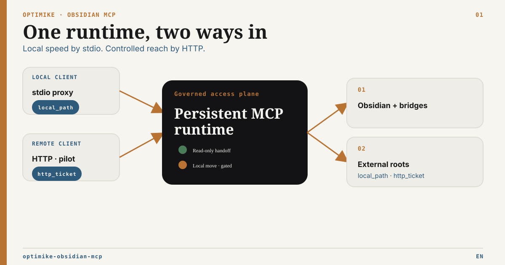

# Optimike Obsidian MCP

[](https://github.com/optimikelabs/optimike-obsidian-mcp/releases/latest)

French version: [README.fr.md](README.fr.md) · [Documentation hub](docs/README.md) · [Operations](OPERATIONS.md) · [Security](SECURITY.md)



Optimike Obsidian MCP gives MCP clients a governed operational surface over an Obsidian vault: live Desktop operations, resilient headless modes, Tasks and Operon, Bases and Canvas, semantic search, runtime observability, and bounded access to configured external documents. Release history lives in the [changelog](CHANGELOG.md) and the [release notes](docs/releases/).

## What this changes for you

Any connection lets an AI read a vault. Optimike Obsidian MCP matters when your AI writes to it: you can hand it the vault without re-checking behind it.

| You want to… | What the MCP does |
| --- | --- |
| Approve before the AI writes | It prepares a plan; what gets written is exactly what you approved, then it is verified. If the connection drops, the write is not blindly replayed. |
| Keep writing while it works | Its write is refused if the note changes between its plan and the write, so an edit made meanwhile is not overwritten. |
| Keep Bases, links and tasks correct | Obsidian-format properties, moves through Obsidian, deletion to the trash, Operon tasks through Operon. |
| Have your rules applied | Before each write, the AI is pointed to the `AGENTS.md` files that apply, from Claude, ChatGPT or Codex; a strict mode refuses the write until it has read them. |
| Find the right passage | Semantic search returns the passage that answers, with its lines. |

These guarantees apply to governed writes: Obsidian open and the Atomic Write Bridge plugin, whose writes stay off until you enable them in its settings. If your AI only reads your vault, file access or a lighter MCP is enough.

## Capability map

| Area                    | What the MCP provides                                                  | Main dependency                                            |
| ----------------------- | ---------------------------------------------------------------------- | ---------------------------------------------------------- |
| Notes                   | Read/search/direct edits plus governed note and Frontmatter operations | Vault; Local REST API + Atomic Write Bridge                |
| Bases and Canvas        | Queries, formula checks by Obsidian's engine, bounded writes, governed formulas and Canvas graph plans | Bases Bridge; Atomic Write Bridge                          |
| Tasks                   | Tasks-compatible Markdown plus 27 governed Operon tools                | Operon Developer API V1 through the Bridge                 |
| Semantic search         | Smart Connections index search                                         | `.smart-env` or an external v3 generation, plus a compatible query embedder |
| Runtime                 | Shared SQLite cache, health, maintenance and degraded modes            | Local filesystem                                           |
| External documents      | Default-deny reads/handoff plus opt-in local move                      | Explicit root allowlist                                    |
| Headless administration | Guarded metadata and filesystem operations                             | Copied or dedicated vault                                  |

The canonical tool registry is documented in [Tool Surface](docs/obsidian_mcp_tools_spec.md).

## Runtime and transport

| Need                                     | Recommended runtime / transport                          |
| ---------------------------------------- | -------------------------------------------------------- |
| Local agent                              | stdio proxy                                              |
| Obsidian Desktop automation              | `live` or `hybrid`                                       |
| CI/server/synchronized copy              | `headless-readonly`                                      |
| Bounded writes on copied/dedicated vault | `headless-guarded`, then `headless-filesystem`           |
| Same-machine HTTP                        | authenticated loopback HTTP                              |
| Remote HTTP                              | reviewed TLS reverse proxy + private network; pilot only |

Runtime answers what the backend can execute. It does not decide how many tools the model should see.

## Tool surface profiles

| Need                                              | Profile     | Full live/hybrid size |
| ------------------------------------------------- | ----------- | --------------------: |
| General vault work                                | `standard`  |                    32 |
| Notes, tags, Bases and Canvas authoring           | `authoring` |                    56 |
| Tasks / Operon workflows                          | `tasks`     |                    38 |
| Complete daily workflows with governed preference | `operational` | 101 |
| Explicit complete, admin and specialized surfaces | `full`      |                    106 |

The counts above exclude three optional asset tools: the current local configuration exposes 104 operational and 109 full tools. The local launcher explicitly selects operational; the package-wide unspecified default remains standard.

In 3.0, an unspecified profile defaults to `standard`. `smart_semantic_search` is the only registered semantic-search name; the former `smart_search` and `smart-search` aliases have been removed. `full` remains an explicit opt-in for the complete active-runtime surface. `bases_upsert_config` is a `full`-only whole-Base compatibility path; legacy whole-file config writes are default-off, while normal authoring uses bounded Base creation/row writes plus the governed formula family.

Select the profile before `tools/list`:

```bash
node dist/stdio-proxy.js --tool-profile standard
```

HTTP profile routes: `/mcp/standard`, `/mcp/authoring`, `/mcp/tasks`, `/mcp/full`, `/mcp/operational`.

Unqualified `/mcp` now uses `standard`; `/mcp/full` remains the explicit complete route. See [Tool Surface Profiles](docs/tool-surface-profiles.md).

## Quick start

Requirements:

- Node.js `>=22.12.0`;
- Obsidian Desktop only for live features;
- capability-specific plugins listed below.

```bash
git clone https://github.com/optimikelabs/optimike-obsidian-mcp.git
cd optimike-obsidian-mcp
npm install
npm run build
node dist/stdio-proxy.js --tool-profile standard
```

Package binaries:

```text
optimike-obsidian-mcp
optimike-obsidian-mcp-proxy
```

Minimal Codex configuration:

```toml
[mcp_servers.optimike-obsidian-mcp-stdio]
command = "node"
args = [
  "/path/to/optimike-obsidian-mcp/dist/stdio-proxy.js",
  "--tool-profile",
  "standard"
]

[mcp_servers.optimike-obsidian-mcp-stdio.env]
OBSIDIAN_VAULT = "/path/to/vault"
OBSIDIAN_RUNTIME_MODE = "live"
OBSIDIAN_BASE_URL = "http://127.0.0.1:27123"
OBSIDIAN_API_KEY = "<local-rest-api-key>"
```

Keep real paths, API keys, journals and external-root configuration outside the repository and distributable vault content. To connect a private local runtime to ChatGPT without a public endpoint or a Chat On Steroids dependency, see [ChatGPT through Secure MCP Tunnel](docs/chatgpt-secure-tunnel.md).

## Optional Obsidian integrations

Enable only the surfaces you use:

- [Local REST API](https://github.com/coddingtonbear/obsidian-local-rest-api) for live note, metadata and tag operations;
- bundled **Bases Bridge** for live Bases and governed formula CAS;
- bundled **Optimike Atomic Write Bridge** for governed Note replacement, body text patch, Frontmatter and Canvas `plan → apply → status → recover`, governed note deletion, and governed Base and Canvas creation. MCP 3.19.x ships Atomic Write Bridge 0.9.2 (Base and Canvas creation need 0.9.0 or later, dating a note with Frontmatter Date Manager before a plan needs 0.9.2; the other governed families accept 0.8.4 or later): deploy and roll back both as one pair;
- **Smart Connections** for the local semantic index;
- **Operon Developer API V1** and bundled **Optimike Operon Bridge 0.9.9** for governed task operations. Optimike MCP `3.9.1` certifies official Operon `3.9.3` against Developer API V1 with Operon CLI `1.2.0` and Local REST API `5.1.0`; release admission follows the [proportionate qualification policy](docs/bridge-packaging.md#proportionate-release-qualification), with the exact-SHA Pilot 2 gate for changed or unqualified paths. The public Developer API contract and additive workflow boundary did not drift from `3.6.2`; Pilot 2 verifies native preview/apply, idempotent replay, stale-revision rejection, typed media, exact restoration and zero pending recovery. Future non-denied releases remain `compatible-provisional` until separately evidenced. The three bundled Bridges [recover their Local REST routes after late startup or reload](docs/bridge-lifecycle.md) without restarting the MCP or changing write authorization. Their [single verified release bundle](docs/bridge-packaging.md) preserves plugin settings and supports fenced rollback.
- **Obsidian Tasks** for Tasks-compatible Markdown parsing.

Operon mutations require the Bridge mutation setting plus:

```text
OPERON_MUTATIONS_ENABLED=true
```

Stale Operon snapshots remain read-only. No Operon route falls back to raw Markdown or private APIs. Official adoption and Daily/Weekly routing negotiate their exact additive grant on first use, including after a cold MCP start; a pending or refused grant still fails closed. Operon owns every opaque sealed plan and same-plan recovery. Task Type and Task Image stay scalar, Task Gallery stays an ordered array, and `__taskDataType` is read-only. Full compatibility, certified/provisional versions, recovery semantics and current API gaps live in the [Operon MCP contract](docs/operon-mcp-contract.md) and [CLI / Developer API audit](docs/operon-cli-audit.md).

Operon `3.6.0` exposes the public periodic Task Workflow plan as metadata-only, without a pre-apply task-source path. The exact-SHA release canary negotiates and previews periodic operations but skips periodic applies with reason
`public_task_source_projection_unavailable`. This contains the destructive canary
without disabling runtime tools; upstream public path projection is a nonblocking follow-up, and no full periodic certification is claimed. Core startup, adoption, media, Frontmatter Date Manager, idempotence and restoration gates remain mandatory.

## Governed operations

Governed Note replacement, body text patch, Frontmatter, Base formula and Canvas families are exposed atomically:

```text
plan → apply → status → recover
```

After timeout or transport loss, call `status` before `recover`; never create a blind replacement mutation. Durable plans are not bound to the profile that created them. When the vault keeps agent rules in `AGENTS.md`, every write plan lists the files that apply to the paths it writes, and `MCP_VAULT_INSTRUCTIONS=enforce` refuses writes until the agent has received them in their current version; the server proves they were served, not that they are followed ([Vault agent instructions](docs/vault-instructions.md)).

If the client lost the opaque plan reference, call `obsidian_list_pending_operations`. The readonly cockpit lists only pending or uncertain governed Obsidian receipts from the live runtime's already-open journals, with the exact domain `planRef` and the next safe action. It never exposes targets, idempotency keys, content, hashes or backend bindings, and it never invokes status, apply or recovery. See [Pending Operation Cockpit](docs/operation-cockpit-p5.md). Uncertain operations that nothing can settle are closed, after owner review, with `obsidian_operation_close` ([Administrative closure](docs/administrative-closure.md)).

## External document roots

External roots are disabled by default. They are an authorization broker, not an index, sync engine or backup system.

`external_handoff` is transport-aware:

- local stdio returns a verified short-lived `local_path`;
- authenticated direct HTTP may return an opt-in, identity-bound, single-use `http_ticket`;
- neither delivery mode authorizes mutation or reveals the physical source path.

`external_references_scan`, `external_move_plan` and `external_move_status` are
diagnostic only. `external_move_apply`, `external_move_rollback` and any automatic mutating recovery are disabled on every platform until an audited native handle-relative mutation primitive exists; the runtime reason is
`native_handle_relative_mutation_unavailable`. The contract still preserves
redacted receipts, private SQLite snapshots, legacy-binding and stale session/binding checks, and exact-CAS evidence for a future implementation.

The MCP core does not embed PDF, Office or OCR engines. The caller owns binary extraction and verifies size and SHA-256.

See [External Roots Setup](docs/external-roots-setup.md).

## Semantic search

`smart_semantic_search` is the canonical semantic-search tool. By default, it searches the local Smart Connections index. Query embedding can remain local through Ollama, use an OpenAI-compatible provider, or reuse the Smart Connections built-in model (BGE Micro by default) once the optional `@huggingface/transformers` package is installed. See [embedders](README_EMBEDDERS.md). Set `granularity` to `sections` to get the heading sections and paragraphs that answer instead of whole notes, or to `both` to rank notes and sections together; the default `notes` keeps the previous result shape. A section result gives the note `path`, the Smart Connections `block_key`, its `headings` path, `lines` `[start, end]` (1-based, inclusive) and the `score`; with `with_snippets`, `snippet` holds those lines (at most 1,200 characters). Sections use the block vectors Smart Connections already computes for the active model (`.smart-env/smart_blocks/<model fingerprint>`); frontmatter blocks are not searched, and the `folders` and `tags` filters apply to the note of each section. Before answering, the server checks each section against the note as it reads now: `lines_verified: true` proves the lines hold exactly the text that was embedded, found again at its new place when an edit above moved it; `false` means that text changed since Smart Connections indexed it, so `lines` are those of the indexed version and no snippet is returned. A vault without block vectors for the active model answers `semantic_sections_unavailable`. [Ranked and hybrid search](OPERATIONS.md#ranked-and-hybrid-search).

Set `SMART_ENV_GENERATION_POINTER` to read an external Smart Env v3 index and receive its `generation_id`. New publications take effect on the next request. See the [publication contract](docs/semantic-vector-cache-encoding.md#external-smart-env-v3-generations) and [Operations](OPERATIONS.md).

## Verification

```bash
npm run build
npm run test:runtime
npm run test:governed-note-replace-mcp
npm run check:operon
npm run test:external-roots
npm run test:docs
npm run test:package
npm run audit:production
```

Runtime suites use disposable vaults and run in Linux/Windows CI.

## Documentation

- [Installation choices](docs/installation-options.md) : profile, shared HTTP quota and optional FDM integration.
- [Documentation hub](docs/README.md)
- [Tool Surface Profiles](docs/tool-surface-profiles.md)
- [Tool Surface](docs/obsidian_mcp_tools_spec.md)
- [Runtime Capability Matrix](docs/runtime-capability-matrix.md)
- [Runtime Capability Doctor](docs/capability-doctor.md)
- [Bridge Lifecycle Recovery](docs/bridge-lifecycle.md)
- [Bridge Bundle, Upgrade and Rollback](docs/bridge-packaging.md)
- [MCP Routing Guide](docs/mcp-routing-guide.md)
- [Tool Routing Evaluation and Profile Decision](docs/tool-routing-evaluation-p6.md)
- [Operon MCP Contract](docs/operon-mcp-contract.md)
- [External Roots Setup](docs/external-roots-setup.md)
- [Headless Server Profile](docs/headless-server-profile.md)
- [Gateway Compatibility](docs/gateway-compatibility.md)
- [Vault agent instructions (AGENTS.md)](docs/vault-instructions.md)
- [ADR Index](docs/adr/README.md)

## Credits

Created by **Optimike — Mickaël Ahouansou**.

## License

See [LICENSE](LICENSE).
